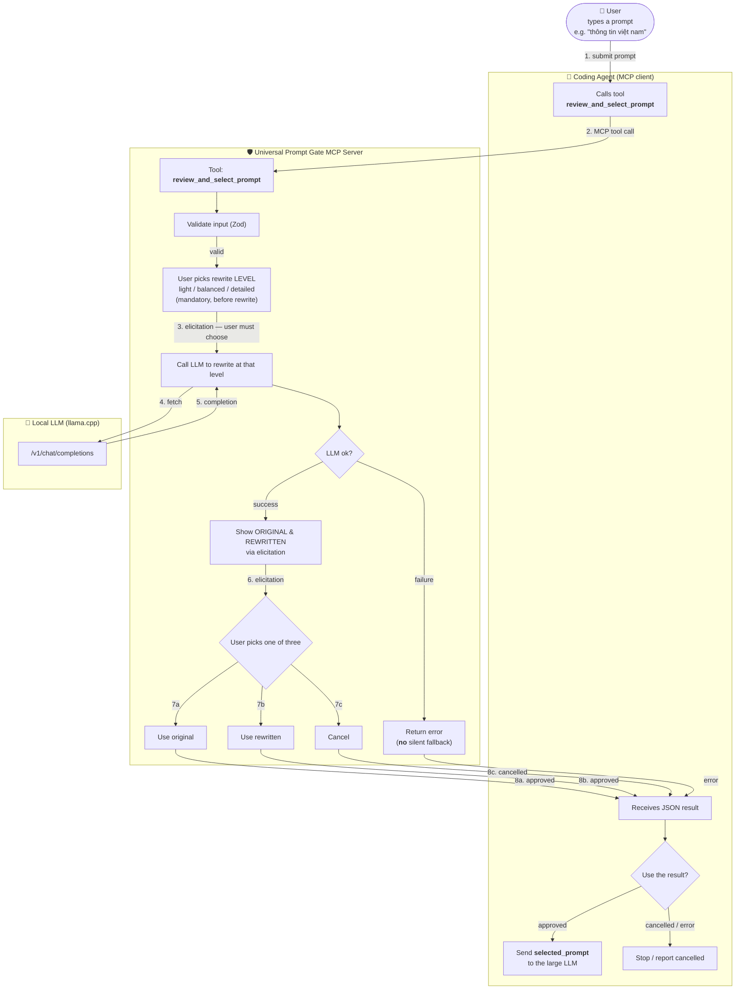

# Universal Prompt Gate MCP Server

> A standalone MCP server that works with many coding agents. It lets users review and select a prompt **before** it is sent to an LLM. It rewrites prompts using a local LLM, has the user pick the enrichment level first, displays 3 choices (original / rewritten / cancel), and keeps the flow safe and flexible for agents.

## Core use case

You type a short prompt in an agent:

```
"thông tin việt nam"
```

First, the user picks the enrichment level (light / balanced / detailed).
The MCP server then rewrites (enriches) it with a local LLM (llama.cpp) into:

> "Summarize the latest news about Vietnam today, categorized by economy, politics, society, and technology. Prioritize reliable sources."

Before the prompt is forwarded to the large LLM, the user is shown 3 choices:

```
[1] Use original prompt     ("thông tin việt nam")
[2] Use rewritten prompt    (the enriched version above)
[3] Cancel                  (do not call the LLM)
```

The user picks one; the chosen prompt (or a "cancelled" state) is then sent to the large LLM. This is the **core flow** of the server.

## Key features

- **Prompt review & rewrite before sending**: every prompt passes through a "gate"; nothing is forwarded automatically
- **User picks the enrichment level**: `light` / `balanced` / `detailed` — interactive picker, never agent-chosen
- **3 user choices**: (1) use the original, (2) use the rewritten, (3) cancel
- **Rewrite = context enrichment**: adds missing context, output structure, and quality criteria — **no new intent**, avoiding drift
- **Local LLM rewrite** (llama.cpp, OpenAI-compatible) — prompts never leave your machine
- **Works with many coding agents**: Claude Code, Cursor, Cline, Continue, OpenCode, …
- **2 integration modes**:
  - **Standard MCP mode** — the agent calls the tool; the MCP server handles the elicitation UI
  - **Mandatory Gating** (when the agent supports hooks) — the prompt is **not** forwarded until the user confirms
- **Multi-provider LLM**: local llama.cpp, OpenAI (cloud), custom endpoint
- **Safety**: no full-prompt logging, no shell execution from prompts, secrets redacted in logs, timeout & cancellation, no placeholder credentials

## MCP tools

| Tool                       | Main input                                                                                                                                                                         | Main output                                                                                                                                                                                                                                                                                                                                                                   |
| -------------------------- | ---------------------------------------------------------------------------------------------------------------------------------------------------------------------------------- | ----------------------------------------------------------------------------------------------------------------------------------------------------------------------------------------------------------------------------------------------------------------------------------------------------------------------------------------------------------------------------- |
| `rewrite_prompt`           | `prompt` (required), `language`?, `context`?, `rewrite_level` (`light`/`balanced`/`detailed`)                                                                                      | `original_prompt`, `rewritten_prompt`, `changes_summary`, `warnings`?                                                                                                                                                                                                                                                                                                         |
| `review_and_select_prompt` | `prompt` (required), `language`?, `context`?; after `pending_level_selection` (text fallback): `rewrite_level`?; after `pending_user_selection`: `selection`?, `rewritten_prompt`? | Approved: `status=approved`, `selected_option` (`original`/`rewritten`), `selected_prompt`, `original_prompt`, `rewritten_prompt` · Cancelled: `status=cancelled`, `selected_option=cancel`, `selected_prompt=null` · No-elicitation fallback: `status=pending_level_selection` (level menu; no rewrite yet) then `status=pending_user_selection` + both versions + 3 choices |
| `get_client_capabilities`  | —                                                                                                                                                                                  | `elicitation_supported`, `structured_elicitation_supported`, `transport`, `integration_mode`, `mandatory_gating_enforceable`                                                                                                                                                                                                                                                  |

> **Key principles:**
>
> - `rewrite_prompt` **never** claims the rewritten prompt is approved — it only produces a candidate rewrite.
> - `review_and_select_prompt` is the "gate" tool — it returns an approved prompt only after the user **explicitly chooses**.
> - **Cancel ≠ approved**: when the user cancels, the response is a distinct protocol outcome (`status=cancelled`) and **never** exposes an approved prompt.
> - **No silent fallback**: on LLM error, the original is **not** auto-selected. A clear error is returned.
> - **No auto-select on timeout**: the user must choose manually; nothing is auto-selected by default.

Full schema & behavior: [`docs/ARCHITECTURE.md`](docs/ARCHITECTURE.md).

## Installation

Requires **Node.js 20+**.

```bash
# 1. Clone & install
cd tool-prompt-rewrite-mcp
npm install

# 2. Build
npm run build

# 3. Run with MCP Inspector (try the tools)
npm run inspector
```

## Configuration (environment variables)

Create a `.env` file (see `.env.example`) or export the variables directly:

| Variable                          | Default                                                          | Description                                                                                                                                                                                                         |
| --------------------------------- | ---------------------------------------------------------------- | ------------------------------------------------------------------------------------------------------------------------------------------------------------------------------------------------------------------- |
| `PROMPT_GATE_LLM_BASE_URL`        | `http://127.0.0.1:8080/v1`                                       | LLM endpoint (OpenAI-compatible)                                                                                                                                                                                    |
| `PROMPT_GATE_LLM_MODEL`           | `qwen3.5-9b` _(example — verify against your llama.cpp version)_ | Model name                                                                                                                                                                                                          |
| `PROMPT_GATE_LLM_API_KEY`         | `local-dev-key`                                                  | API key (for local dev, no real key needed)                                                                                                                                                                         |
| `PROMPT_GATE_TIMEOUT_MS`          | `180000`                                                         | LLM timeout in ms (thinking models on CPU need more time)                                                                                                                                                           |
| `PROMPT_GATE_LLM_RETRY_MAX`       | `3`                                                              | Retry count for network errors (idempotent calls only)                                                                                                                                                              |
| `PROMPT_GATE_LLM_MAX_TOKENS`      | `2048`                                                           | Max completion tokens (thinking models need a larger budget)                                                                                                                                                        |
| `PROMPT_GATE_LLM_ENABLE_THINKING` | _(unset)_                                                        | `true`/`false` — enable/disable reasoning (qwen3 / llama.cpp thinking models)                                                                                                                                       |
| `PROMPT_GATE_LLM_EXTRA_JSON`      | _(unset)_                                                        | JSON object merged into the LLM request body (e.g. `{"chat_format":"chatml"}`)                                                                                                                                      |
| `PROMPT_GATE_ECHO_FALLBACK`       | `true`                                                           | When the client does not support MCP elicitation, the gate tool returns `pending_level_selection` / `pending_user_selection` text menus instead of a hard error (agent re-calls with `rewrite_level` / `selection`) |
| `PROMPT_GATE_TRANSPORT`           | `stdio`                                                          | `stdio` or `http`                                                                                                                                                                                                   |
| `PROMPT_GATE_EXTERNAL_LLM`        | _(unset)_                                                        | Optional: cloud LLM endpoint                                                                                                                                                                                        |
| `PROMPT_GATE_REWRITE_POLICY_FILE` | _(unset)_                                                        | Custom meta-prompt policy file (presets: `news`/`code`/`research`, …) — overrides the default strategy                                                                                                              |

> **Two separate axes:**
>
> - **Per-call**: `rewrite_level` — `light` / `balanced` / `detailed`. In the **gate tool** (`review_and_select_prompt`) it is **chosen by the user** via the picker (the agent must not decide it); in `rewrite_prompt` (no picker) the agent chooses it directly.
> - **Global default** (env): `PROMPT_GATE_REWRITE_POLICY_FILE` — the meta-prompt preset
>
> `rewrite_level` decides the enrichment depth for that call; `PROMPT_GATE_REWRITE_POLICY_FILE` selects the meta-prompt used as the system prompt. `qwen3.5-9b` is an **example** — verify the model name against your llama.cpp version.

## When the client does not support elicitation (text fallback)

Some agents (older VS Code, Cline, Continue, …) do not declare the MCP
`elicitation` capability. When that happens, the gate tool
`review_and_select_prompt` cannot show an interactive picker. The server has
two behaviors, controlled by `PROMPT_GATE_ECHO_FALLBACK`:

- **`true` (default) — echo fallback:** the flow runs over plain-text menus
  instead, as up to 3 calls:

  1. **Level menu.** The first call returns
     `status: "pending_level_selection"` (the prompt has **not** been
     rewritten yet — no LLM call) with the three numbered levels:

     ```text
     [1] light — minimal changes; keep close to the original
     [2] balanced — add missing structure, context, and quality criteria
     [3] detailed — full spec with acceptance criteria
     ```

     The agent asks the user which level to use and re-calls the tool with
     the SAME inputs plus `rewrite_level` set to the user's choice. The agent
     must never pick for the user.

  2. **Selection menu.** The tool now rewrites the prompt and returns
     `status: "pending_user_selection"` with both versions in plain text and
     the three numbered choices:

     ```text
     [1] original — use the user's exact text
     [2] rewritten — use the LLM-enriched version
     [3] cancel — use neither; abort the prompt gate
     ```

     The agent asks the user, then re-calls with `selection` set to
     `"original"` / `"rewritten"` / `"cancel"` (and, for `rewritten`, the
     `rewritten_prompt` text the user saw).

  3. **Final call.** Returns the normal approved/cancelled outcome. This
     call does **not** invoke the LLM again.

- **`false` — strict:** the tool returns a hard compatibility error, as in
  the original design. Use this when you want to refuse to gate at all
  unless the client supports elicitation.

The echo fallback is **not** a silent fallback: it never auto-selects, never
forwards the prompt without an explicit user choice (level **and** version),
and cancellation still exposes no approved prompt.

## Run a local LLM (llama.cpp)

```bash
# Download a model (one time)
./llama-server -m qwen3.5-9b -c 8192 --port 8080 --api-key local-dev-key

# Verify
curl http://127.0.0.1:8080/v1/models
```

The MCP server calls this endpoint to rewrite prompts. No internet required.

## Run the MCP server

```bash
# Default (stdio) — for desktop agents
node build/index.js

# Or via package.json
npm start
```

## Integrate with agents

> **Standard MCP mode** is the default and works with every MCP-capable agent. Mandatory Gating (hooks) is an **extension** — optional, and only possible when the agent exposes a hook API.

### Example MCP server configuration

Add the server to your agent's config (common JSON shape):

```json
{
  "mcpServers": {
    "prompt-gate": {
      "command": "node",
      "args": ["/absolute/path/to/tool-prompt-rewrite-mcp/build/index.js"]
    }
  }
}
```

Or, when installed from npm:

```json
{
  "mcpServers": {
    "prompt-gate": {
      "command": "npx",
      "args": ["-y", "universal-prompt-gate-mcp"]
    }
  }
}
```

Each agent has a different configuration mechanism — see the [compatibility matrix](docs/ARCHITECTURE.md#3-agent-compatibility-matrix).

### Passing configuration (env) to the server — 3 ways

The server reads config with this precedence (higher wins):

```
1. Real environment variables (passed by the MCP client via `env`/`environment` in its JSON config)
2. A `.env` file (auto-loaded: PROMPT_GATE_ENV_FILE → CWD → next to build/index.js)
3. Built-in defaults
```

#### Option A — `env` in JSON (recommended when publishing)

Claude Code / Cursor / VS Code Copilot use the `mcpServers` (or `servers`) key plus an `env` field:

```json
{
  "mcpServers": {
    "prompt-gate": {
      "command": "node",
      "args": ["/absolute/path/to/build/index.js"],
      "env": {
        "PROMPT_GATE_LLM_BASE_URL": "http://127.0.0.1:8080/v1",
        "PROMPT_GATE_LLM_MODEL": "qwen3.5-9b",
        "PROMPT_GATE_LLM_MAX_TOKENS": "4096",
        "PROMPT_GATE_TIMEOUT_MS": "300000",
        "PROMPT_GATE_LLM_ENABLE_THINKING": "false"
      }
    }
  }
}
```

> OpenCode V2 uses `mcp.servers` with an `environment` field, and `command` is an array:
>
> ```jsonc
> {
>   "mcp": {
>     "servers": {
>       "prompt-gate": {
>         "type": "local",
>         "command": ["node", "/absolute/path/to/build/index.js"],
>         "environment": { "PROMPT_GATE_LLM_MODEL": "qwen3.5-9b" },
>       },
>     },
>   },
> }
> ```

#### Option B — a `.env` file (local dev)

Copy `.env.example` → `.env` at the repo root. The server **loads it automatically** at startup (no `env` needed in JSON). When a client spawns the server from a different CWD, the server looks for `.env` next to `build/index.js` (the repo). Set `PROMPT_GATE_ENV_FILE=/path/to/.env` to point to a specific file.

#### Option C — custom provider (ship your own, used when publishing)

```json
"env": {
  "PROMPT_GATE_PROVIDER": "custom",
  "PROMPT_GATE_CUSTOM_PROVIDER_MODULE": "/absolute/path/to/my-provider.js"
}
```

`my-provider.js` must export:

```js
export function createCustomLLMProvider(cfg) {
  // cfg: LLMConfig (baseUrl, model, apiKey, timeoutMs, retryMax, maxTokens, …)
  return {
    isConfigured: () => true,
    chat: async (messages, options) => {
      // call your endpoint/model/API, return a STRING (the completion).
      // throw on error — the server maps it to a GateError.
      return await callYourApi(messages, options);
    },
  };
}
```

→ Ship this provider as a separate package (e.g. `@me/my-llm-provider`) and point `PROMPT_GATE_CUSTOM_PROVIDER_MODULE` at the installed file (`require.resolve` / absolute path). No need to edit the prompt-gate package source.

### Provider-related env variables

| Variable                             | Default                    | Meaning                                                           |
| ------------------------------------ | -------------------------- | ----------------------------------------------------------------- |
| `PROMPT_GATE_PROVIDER`               | `openai-compatible`        | `openai-compatible` / `openai` / `custom`                         |
| `PROMPT_GATE_CUSTOM_PROVIDER_MODULE` | _(unset)_                  | Path to a custom provider module (only used when provider=custom) |
| `PROMPT_GATE_LLM_BASE_URL`           | `http://127.0.0.1:8080/v1` | OpenAI-compatible endpoint                                        |
| `PROMPT_GATE_EXTERNAL_LLM`           | _(unset)_                  | Override the base URL (cloud endpoint)                            |
| `PROMPT_GATE_LLM_MODEL`              | `qwen3.5-9b`               | Model name                                                        |
| `PROMPT_GATE_LLM_MAX_TOKENS`         | `2048`                     | Max completion tokens                                             |
| `PROMPT_GATE_TIMEOUT_MS`             | `180000`                   | Timeout in ms                                                     |
| `PROMPT_GATE_LLM_ENABLE_THINKING`    | _(unset)_                  | `true`/`false` — disable reasoning (qwen3 / llama.cpp)            |
| `PROMPT_GATE_LLM_EXTRA_JSON`         | _(unset)_                  | JSON object merged into the LLM request body                      |
| `PROMPT_GATE_ENV_FILE`               | _(unset)_                  | Explicit path to a `.env` file                                    |

### Which tool to use when

- **`rewrite_prompt`** — when you just want to see an enriched version, without a user gate (e.g. preview).
- **`review_and_select_prompt`** — when you need a real "gate": the user must choose before the prompt is used. This is the primary tool of the "Universal Prompt Gate".
- **`get_client_capabilities`** — to check whether the connected client supports elicitation, before calling the gate tool.

## How it works

### Workflow diagram (Mermaid)



> Diagram source: [`docs/WORKFLOW.md`](docs/WORKFLOW.md).

### Standard MCP Mode

```
1. Agent submits a prompt ("thông tin việt nam")
2. Agent calls the MCP tool → user picks the enrichment level (light/balanced/detailed)
3. LLM (llama.cpp) rewrites the prompt at that level
4. MCP server returns the original & the rewritten version (via the elicitation UI)
5. MCP server shows the 3 choices (1/2/3)
6. User picks one (1/2/3)
7. MCP server returns the chosen prompt (or the "cancelled" state)
8. Agent sends that prompt (or stops if cancelled)
```

### Mandatory Gating (when the agent supports hooks)

An agent hook intercepts the prompt → calls `review_and_select_prompt` → inside the MCP server:

```
User picks the level (light / balanced / detailed)
    → Rewrite the prompt at that level (llama.cpp)
    → Show the choices (elicitation)
    → User selects & confirms
    → Return the result (or cancel)
```

The prompt is **not** forwarded when the user picks "Cancel".

### Cancellation Flow

```
User picks Cancel → MCP Server confirms the cancellation → The prompt is not forwarded to the agent/LLM
Response: { status: "cancelled", selected_option: "cancel", selected_prompt: null }
```

> Cancel is a **distinct protocol outcome** — the response **does not** expose `selected_prompt`. There is no silent fallback to the original on LLM errors.

## Safety & security

- Input length limits, output validation (Zod)
- Timeout & cancellation (explicit, no auto-select)
- Injection detection; the prompt is treated as untrusted data
- Session management (pending requests), isolation per session/request ID, cleanup of abandoned requests
- **No silent fallback**: on LLM error, the original is **not** auto-selected — a clear error is returned
- **No auto-select on timeout**: the user must choose manually
- **Cancel = distinct outcome**: response `status=cancelled`, **no** approved prompt exposed
- No full-prompt logging; secrets redacted in logs; no placeholder credentials
- No auto-forward on cancel; no shell execution from prompts

## Testing

```bash
# Run unit + integration tests (mocked LLM, no llama.cpp required)
npm test

# Watch mode
npm run test:watch

# Coverage
npm run test:coverage
```

Test coverage includes:

- Rewrite (success, timeout, malformed, language/context pass-through)
- Review/select: user-chosen level picker (before the rewrite), original, rewritten, cancel, cancellation via action, LLM error (no fallback), elicitation unsupported + text fallback flow (`pending_level_selection` → `pending_user_selection` → approval), invalid selection
- Capability detection (conservative default, no name-based inference)
- Concurrent sessions (isolation)
- Logger (redaction, stderr-only)
- Config (env defaults, overrides, clamping)

## Development & build

```bash
npm run typecheck   # tsc --noEmit
npm run lint         # eslint
npm run format       # prettier
npm run build        # tsc
npm run dev          # tsx (no build)
```

## Project structure

```
tool-prompt-rewrite-mcp/
├── package.json
├── tsconfig.json
├── tsconfig.test.json
├── eslint.config.js
├── .prettierrc
├── .env.example
├── .gitignore
├── README.md
├── docs/
│   ├── ARCHITECTURE.md
│   ├── AGENT_INTEGRATION.md
│   ├── WORKFLOW.md
│   └── Universal Prompt Gate MCP Architecture.png
├── src/
│   ├── index.ts                  # entry (stdio)
│   ├── config.ts                 # load env → typed config
│   ├── logger.ts                 # safe logger (stderr, redaction)
│   ├── types.ts                  # shared domain types
│   ├── elicitation.ts            # MCP elicitation wrapper
│   ├── capability/
│   │   └── capability.ts         # client capability detection
│   ├── session/
│   │   └── session.ts            # pending-request management
│   ├── llm/
│   │   ├── index.ts              # provider factory
│   │   └── provider.ts           # OpenAI-compatible provider + retry
│   ├── rewrite/
│   │   └── rewrite.ts            # meta-prompts + RewriteService
│   └── tools/
│       ├── index.ts              # tool registration
│       ├── rewritePrompt.ts      # rewrite_prompt tool
│       ├── reviewAndSelect.ts    # review_and_select_prompt tool (the gate)
│       └── getClientCapabilities.ts
└── test/
    ├── rewrite.test.ts
    ├── review.test.ts
    ├── cancellation.test.ts
    ├── concurrent.test.ts
    ├── capability.test.ts
    ├── config.test.ts
    ├── logger.test.ts
    └── fixtures/
        └── llm-mocks.ts
```

## Related documentation

- [`docs/ARCHITECTURE.md`](docs/ARCHITECTURE.md) — overall architecture, compatibility matrix, env variables, security
- [MCP Inspector](https://github.com/modelcontextprotocol/inspector) — test & debug the server
- [llama.cpp](https://github.com/ggml-org/llama.cpp) — run a local OpenAI-compatible API
- [Troubleshooting](#troubleshooting)

## Troubleshooting

| Symptom                                                     | Cause                                                                 | Fix                                                                                                                                                                                                                                                                    |
| ----------------------------------------------------------- | --------------------------------------------------------------------- | ---------------------------------------------------------------------------------------------------------------------------------------------------------------------------------------------------------------------------------------------------------------------- |
| `LLM request timed out`                                     | llama.cpp is slow, the model is too large, or a thinking model on CPU | Increase `PROMPT_GATE_TIMEOUT_MS` (e.g. 300000) and `PROMPT_GATE_LLM_MAX_TOKENS` (e.g. 4096)                                                                                                                                                                           |
| `LLM HTTP 401`                                              | Wrong API key                                                         | Check that `PROMPT_GATE_LLM_API_KEY` matches your llama.cpp key                                                                                                                                                                                                        |
| `LLM returned an empty completion`                          | The model produced no text (high temperature, small max_tokens)       | Lower `temperature`, increase `PROMPT_GATE_LLM_MAX_TOKENS` (default 2048, raise if needed)                                                                                                                                                                             |
| `LLM returned empty content but produced reasoning_content` | A thinking model (qwen3/3.5) is not respecting `thinking:false`       | Use a **non-thinking** model (e.g. `qwen2.5-7b`), or upgrade llama.cpp to a build that supports `thinking:false`, or set `PROMPT_GATE_LLM_MAX_TOKENS=4096`+ so the model has enough budget                                                                             |
| Client reports `elicitation_unsupported`                    | The client does not support elicitation                               | Text fallback runs by default: expect `pending_level_selection` / `pending_user_selection` menus and relay the user's choices (`rewrite_level` / `selection`). In strict mode (`PROMPT_GATE_ECHO_FALLBACK=false`) only use the gate when `elicitation_supported: true` |
| Prompt does not go through the gate when using an agent     | The agent has no hooks (standard mode)                                | This is a limit of standard MCP — see [Mandatory Gating](docs/ARCHITECTURE.md#22-mandatory-gating-when-the-agent-supports-hooks)                                                                                                                                       |
| `node build/index.js` does not run                          | Not built yet                                                         | Run `npm run build` first                                                                                                                                                                                                                                              |

## License

[Apache-2.0](LICENSE)
