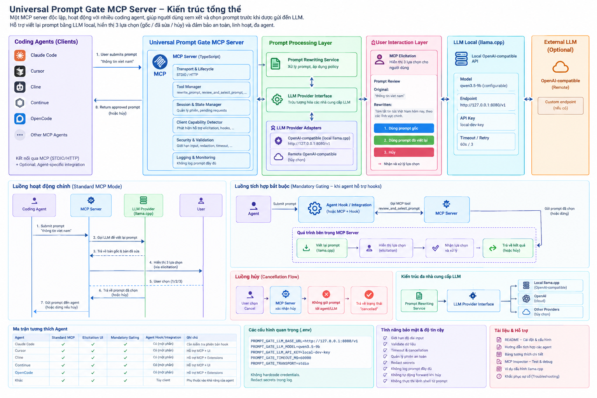
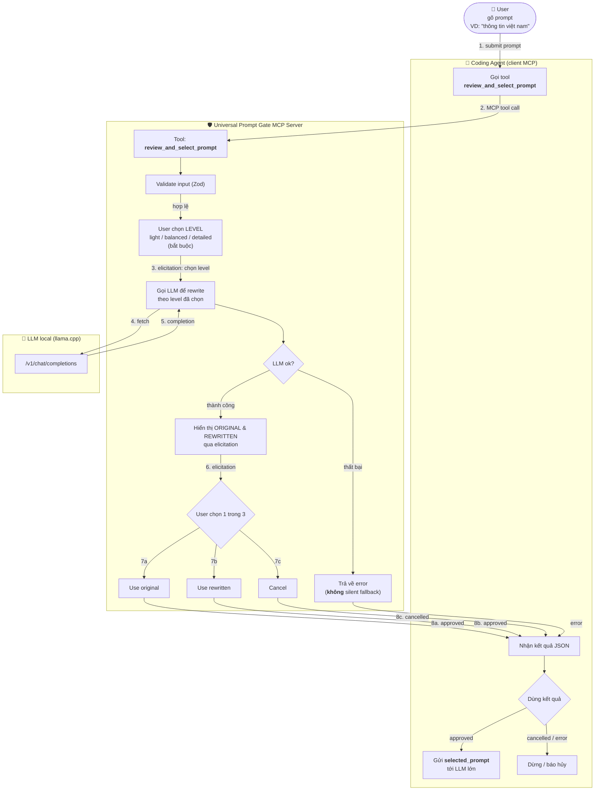

# Universal Prompt Gate MCP Server — Kiến trúc tổng thể

> Một MCP server độc lập, hoạt động với nhiều coding agent, giúp người dùng xem xét và chọn prompt trước khi được gửi đến LLM. Hỗ trợ viết lại prompt bằng LLM local, cho user chọn mức enrich rồi hiển thị 3 lựa chọn (gốc / đã sửa / hủy) và đảm bảo an toàn, linh hoạt cho agent.



## 1. Tổng quan 3 lớp

Kiến trúc chia thành 4 vùng logic (5 khối lớn trên sơ đồ):

### A. Coding Agents (Clients)

Các agent kết nối tới server qua chuẩn MCP (stdio hoặc HTTP):

- Claude Code
- Cursor
- Cline
- Continue
- OpenCode
- Other MCP Agents (khác)

**Giao diện với agent:** 2 hướng —

1. `1. User submits prompt` ("thông tin viết nam") → agent gửi tới MCP Server.
2. `4. Return approved prompt (hoặc hủy)` ← agent nhận prompt được duyệt (hoặc trạng thái hủy).

Hỗ trợ 3 chế độ tích hợp: có thể có prompt trên bản hook (tùy chọn), hoặc agent-specific integration.

### B. Universal Prompt Gate MCP Server (TypeScript)

Lõi MCP, bao gồm:

- **Transport & Lifecycle** — stdio / HTTP
- **Tool Manager** — định nghĩa tool: `rewrite_prompt`, `review_and_select_prompt`, …
- **Session & State Manager** — quản lý phiên, pending requests
- **Client Capability Detector** — phát hiện tính năng trên elicitation, hooks, …
- **Security & Validation** — giới hạn input, injection, timeout, …
- **Logging & Monitoring** — không log prompt đầy đủ

### C. Prompt Processing Layer (Lớp xử lý prompt)

> **Nguyên tắc cốt lõi — Rewrite = Enrich ngữ cảnh (context enrichment)**
>
> Mục đích của "viết lại" **không phải** đổi ý hay thêm ý mới, mà là **cụ thể hóa prompt gốc**:
>
> - Thêm context bị thiếu (địa lý, thời gian, phạm vi)
> - Thêm cấu trúc / tiêu chí output (phân loại theo hạng mục, định dạng)
> - Thêm constraint về chất lượng (nguồn tin đáng tin cậy, độ chính xác)
>
> Ví dụ thực tế:
>
> ```
> Input:  "thông tin việt nam"
> Output: "Tóm tắt những tin tức mới nhất về Việt Nam hôm nay,
>          phân loại theo kinh tế, chính trị, xã hội và công nghệ.
>          Ưu tiên nguồn tin đáng tin cậy."
> ```
>
> Việc này được điều khiển bởi **meta-prompt** (rewrite policy) — cấu hình được, không để LLM tự do phát triển ý.

- **Prompt Rewriting Service** — xử lý prompt, áp dụng policy (enrichment + constraints)
- **LLM Provider Interface** — trừu tượng hóa nhà cung cấp LLM
- **LLM Provider Adapters (hỗ trợ):**
  - OpenAI-compatible (local llama.cpp) — `http://127.0.0.1:8080/v1`
  - Remote OpenAI-compatible (tùy chọn)

### C.1. Rewrite Policy (Meta-Prompt) — cấu hình được

Meta-prompt mẫu (mặc định, có thể override qua env `PROMPT_GATE_REWRITE_POLICY_FILE`):

> Bạn là trợ giúp cụ thể hóa prompt. Nhiệm vụ: giữ nguyên ý chính của prompt gốc,
> nhưng bổ sung context, cấu trúc output và tiêu chí chất lượng thiếu.
> Không thêm ý hoặc requirement mới. Không hỏi lại user. Trả về duy nhất prompt
> đã cụ thể hóa.
>
> Ví dụ tham chiếu:
>
> - Input: "thông tin việt nam"
> - Output: "Tóm tắt những tin tức mới nhất về Việt Nam hôm nay,
>   phân loại theo kinh tế, chính trị, xã hội và công nghệ.
>   Ưu tiên nguồn tin đáng tin cậy."

Chiến lược rewrite (mức `rewrite_level` — trong gate flow do **user chọn** qua picker; trong `rewrite_prompt` preview do agent chọn):

- `light` — enrich tối thiểu: chỉ thêm context & cấu trúc rõ ràng, giữ ngắn gọn
- `balanced` (mặc định) — cụ thể hóa ngữ cảnh + cấu trúc output + tiêu chí chất lượng
- `detailed` — bổ sung thêm acceptance criteria, constraint, ví dụ cụ thể; prompt dài hơn

### C.2. Rewrite LLM — dùng model nhỏ, tách biệt khỏi target LLM

Rewrite chạy bằng **LLM local nhỏ** (qwen3.5-9b), tách hoàn toàn khỏi LLM "lớn" sẽ nhận prompt. Meta-prompt chỉ hướng dẫn enrich — không cho LLM tự do "thêm ý", tránh drift ngữ nghĩa.

### D. User Interaction Layer (Lớp tương tác người dùng)

- **MCP Elicitation** — bước 1: màn chọn mức enrich (`light` / `balanced` / `detailed`) — **user bắt buộc chọn**, agent không được chọn hộ. Bước 2: hiển thị 3 lựa chọn prompt.
- **Prompt Review:**
  - _Original:_ "thông tin việt nam"
  - _Rewritten:_ "Tóm tắt những tin tức mới nhất về Việt Nam hôm nay, phân loại theo kinh tế, chính trị, xã hội và công nghệ. Ưu tiên nguồn tin đáng tin cậy."
- **3 lựa chọn (khung):**
  1. `Dùng prompt gốc` (màu xanh dương)
  2. `Dùng prompt đã viết lại` (màu xanh lá)
  3. `Hủy` (màu đỏ)
- Nhận và xử lý lựa chọn

### E. LLM Local (llama.cpp)

- Local OpenAI-compatible API
- Model: `qwen3.5-9b` (configurable)
- Endpoint: `http://127.0.0.1:8080/v1`
- API Key: `local-dev-key`
- Timeout / Retry: `60s / 3`

### F. External LLM (Optional)

- OpenAI-compatible (Remote)
- Custom endpoint (nếu cần)

---

## 2. Luồng hoạt động

### 2.0. Sơ đồ workflow (Mermaid)

> File nguồn: [`docs/WORKFLOW.md`](WORKFLOW.md) — render trực tiếp trên GitHub.



### 2.1. Standard MCP Mode

```
Coding Agent → MCP Server → LLM Provider (llama.cpp)
   1. Submit prompt "thông tin việt nam"
   2. User chọn mức enrich (light / balanced / detailed) qua elicitation — bắt buộc
   3. Gọi LLM để viết lại prompt theo mức đã chọn
   4. Trả về bản gốc & bản đã sửa (via elicitation)
   5. Hiển thị 3 lựa chọn (1/2/3)
   6. User chọn (1/2/3)
   7. Trả về prompt đã chọn (hoặc hủy)
   8. Gửi prompt đến agent (hoặc dừng nếu hủy)
```

Trên schema, agent, MCP Server, LLM Provider (llama.cpp) và User tương tác tuần tự; bước 2, 4 & 5 qua elicitation UI; bước 6 do người dùng quyết định; bước 8 có thể "hoặc dừng nếu hủy".

### 2.2. Mandatory Gating (Khi agent hỗ trợ hooks)

Agent Hook / Integration (hoặc MCP + Hook) thực thi:

1. `Submit prompt`
2. `Gọi MCP tool review_and_select_prompt`
3. **Bên trong MCP Server (Process):**
   - User chọn mức enrich (light / balanced / detailed) — qua elicitation
   - Viết lại prompt theo mức đã chọn (llama.cpp)
   - Hiển thị lựa chọn (elicitation)
   - Người dùng lựa chọn & xác nhận
   - Trả về kết quả (hoặc hủy)
4. `Gửi prompt đã chọn (hoặc dừng)`

Đây là chế độ "phải duyệt" — prompt không được gửi đi cho đến khi người dùng xác nhận.

### 2.3. Cancellation Flow (Hủy)

```
User chọn Cancel → MCP Server xác nhận hủy → Không gọi gửi prompt tới agent/LLM → Trả về trạng thái "cancelled"
```

### 2.4. Kiến trúc đa nhà cung cấp LLM

`Prompt Rewriting Service` → `LLM Provider Interface` → 3 nhóm:

- Local llama.cpp (OpenAI-compatible)
- OpenAI (cloud)
- Other Providers (bây chọn)

---

## 3. Ma trận tương thích Agent

> ⚠️ **Nguyên tắc "no unverified claims":** chỉ đánh dấu ✓ khi đã **test E2E thực tế**. Trạng thái hiện tại là **TBD** cho Mandatory Gating cho đến khi có E2E test trên từng agent. Không suy luận từ tên agent.

| Agent       | Standard MCP | Elicitation UI | Mandatory Gating | Agent Hook/Integration | E2E Verified | Ghi chú                                                                      |
| ----------- | ------------ | -------------- | ---------------- | ---------------------- | ------------ | ---------------------------------------------------------------------------- |
| Claude Code | ✓            | TBD            | TBD              | Có (native hooks)      | **No**       | Hook native — verify hook có thể **block/modify** prompt hay chỉ add context |
| Cursor      | ✓            | TBD            | TBD              | Mở rộng                | **No**       | Support MCP; UI & hook — verify extension API cho mandatory gate             |
| Cline       | ✓            | TBD            | TBD              | Mở rộng                | **No**       | Support MCP + Extensions — verify extension có thể intercept prompt          |
| Continue    | ✓            | TBD            | TBD              | Mở rộng                | **No**       | Support MCP + UI — verify UI có support elicitation                          |
| OpenCode    | ✓            | TBD            | TBD              | Mở rộng                | **No**       | Support MCP + Extensions — verify hook API                                   |
| Khác        | ✓            | TBD            | TBD              | Tùy client             | **No**       | Phụ thuộc khả năng của agent; "no claim" unless E2E tested                   |

> **"Standard MCP"** ở đây chỉ nghĩa là: agent **có thể gọi** tool MCP (explicit invocation). Nó **không** đồng nghĩa với "mọi prompt của user đều đi qua gate".

## 4. Tool Schemas (chi tiết)

### `rewrite_prompt`

- **Input (Zod):**
  - `prompt: string` (bắt buộc)
  - `language?: string` — ngôn ngữ ưu tiên output
  - `context?: string` — context user bổ sung
  - `rewrite_level?: "light" | "balanced" | "detailed"` — agent chọn trực tiếp (tool này không có picker; mặc định `balanced`)
- **Output:**
  - `original_prompt: string`
  - `rewritten_prompt: string`
  - `changes_summary: string` — mô tả các thay đổi
  - `warnings?: string[]` — cảnh báo (vd: prompt gốc quá dài, model bỏ qua constraint…)
- **Hạn chế:** tool này **chỉ sinh** rewrite — **không** claim đã approve. Approval thuộc về `review_and_select_prompt`.

### `review_and_select_prompt`

- **Input (Zod):**
  - `prompt: string` (bắt buộc)
  - `language?: string`
  - `context?: string`
  - `rewrite_level?: "light" | "balanced" | "detailed"` — **user chọn qua picker** (agent không được chọn hộ; chỉ relay sau `pending_level_selection` khi client không có elicitation)
- **Output khi approve:**
  ```json
  {
    "status": "approved",
    "selected_option": "original" | "rewritten",
    "selected_prompt": "…",
    "original_prompt": "…",
    "rewritten_prompt": "…"
  }
  ```
- **Output khi cancel:**
  ```json
  {
    "status": "cancelled",
    "selected_option": "cancel",
    "selected_prompt": null
  }
  ```
- **Hành vi:**
  1. Validate input (Zod)
  2. Yêu cầu **user** chọn mức enrich (`light` / `balanced` / `detailed`) qua elicitation — agent không được chọn hộ
  3. Sinh rewritten prompt theo mức đã chọn
  4. Hiển thị cả 2 bản qua MCP elicitation (nếu client hỗ trợ)
  5. Yêu cầu user chọn **chính xác 1**
  6. Return **chỉ** prompt approved + decision metadata
  7. Xử lý explicit: cancel, client không support elicitation (trả clear compatibility error / fallback text đã cấu hình — `pending_level_selection` → `pending_user_selection`)
  8. **Không** silent fallback sang original sau error
  9. **Không** auto-select sau timeout

### `get_client_capabilities`

- **Output:**
  - `elicitation_supported: boolean`
  - `structured_elicitation_supported: boolean`
  - `transport: "stdio" | "http"`
  - `integration_mode: "standard" | "hook" | "none"`
  - `mandatory_gating_enforceable: boolean`
- **Nguyên tắc:** chỉ báo cáo **dựa trên protocol negotiation thực tế** + config. **Không** suy luận từ tên agent.

---

## 5. Biến môi trường quan trọng

| Biến                              | Default                                                | Vai trò                                                                                                                                                                                                 |
| --------------------------------- | ------------------------------------------------------ | ------------------------------------------------------------------------------------------------------------------------------------------------------------------------------------------------------- |
| `PROMPT_GATE_LLM_BASE_URL`        | `http://127.0.0.1:8080/v1`                             | Endpoint LLM (OpenAI-compatible)                                                                                                                                                                        |
| `PROMPT_GATE_LLM_MODEL`           | `qwen3.5-9b` _(ví dụ — verify theo llama.cpp version)_ | Tên model LLM                                                                                                                                                                                           |
| `PROMPT_GATE_LLM_API_KEY`         | `local-dev-key`                                        | API key (local)                                                                                                                                                                                         |
| `PROMPT_GATE_TIMEOUT_MS`          | `180000`                                               | Timeout (ms) cho LLM                                                                                                                                                                                    |
| `PROMPT_GATE_LLM_RETRY_MAX`       | `3`                                                    | Retry tối đa (network)                                                                                                                                                                                  |
| `PROMPT_GATE_LLM_MAX_TOKENS`      | `2048`                                                 | Completion tokens tối đa                                                                                                                                                                                |
| `PROMPT_GATE_LLM_ENABLE_THINKING` | _(unset)_                                              | Bật/tắt reasoning (thinking models)                                                                                                                                                                     |
| `PROMPT_GATE_LLM_EXTRA_JSON`      | _(unset)_                                              | JSON object gộp vào body LLM                                                                                                                                                                            |
| `PROMPT_GATE_ECHO_FALLBACK`       | `true`                                                 | Client không support elicitation → gate trả `pending_level_selection` / `pending_user_selection` (fallback text; agent re-call với `rewrite_level` / `selection`) thay vì error (set `false` để strict) |
| `PROMPT_GATE_TRANSPORT`           | `stdio`                                                | Chế độ transport                                                                                                                                                                                        |
| `PROMPT_GATE_EXTERNAL_LLM`        | _(unset)_                                              | Optional: endpoint LLM cloud                                                                                                                                                                            |
| `PROMPT_GATE_REWRITE_POLICY_FILE` | _(unset)_                                              | File meta-prompt tùy chỉnh (preset)                                                                                                                                                                     |

> **Tách 2 trục:** `rewrite_level` (per-call: trong gate flow do **user chọn** qua picker; trong `rewrite_prompt` do agent chọn: `light`/`balanced`/`detailed`) ≠ `PROMPT_GATE_REWRITE_POLICY_FILE` (global default meta-prompt preset).

---

## 6. Tính bảo mật & độ tin cậy

- Giới hạn độ dài input, validate output (Zod)
- Timeout & cancellation (explicit)
- **Không silent fallback**: sau LLM error, **không** auto-chọn original — trả về lỗi rõ ràng
- **Không auto-select sau timeout**: user phải chọn thủ công
- **Cancel = distinct protocol outcome**: response `status=cancelled`, **không** expose approved prompt
- **Echo fallback (client không support elicitation)**: trả về `pending_level_selection` (menu chọn mức, chưa rewrite) rồi `pending_user_selection` (menu 3 lựa chọn dạng text); agent phải re-call tool với `rewrite_level` / `selection` do **user** chọn — không auto-select, không auto-forward. Bật/tắt qua `PROMPT_GATE_ECHO_FALLBACK`
- Phát hiện injection; treat prompt as untrusted data
- Quản lý session; **isolation per session/request ID**; cleanup abandoned requests
- Không log prompt đầy đủ; redact secrets trong log; không placeholder credentials
- Không tự động forward khi hủy; không thực thi shell từ prompt
- STDIO là default; HTTP phải secure (không expose unauthenticated ra public)

## 7. Tài liệu & Hỗ trợ

- `README.md` — Cài đặt & cấu hình
- Hướng dẫn kết nối với agent
- Bảng tương thích chi tiết
- MCP Inspector — Test & debug
- Ví dụ cấu hình llama.cpp
- Khắc phục sự cố (Troubleshooting)
